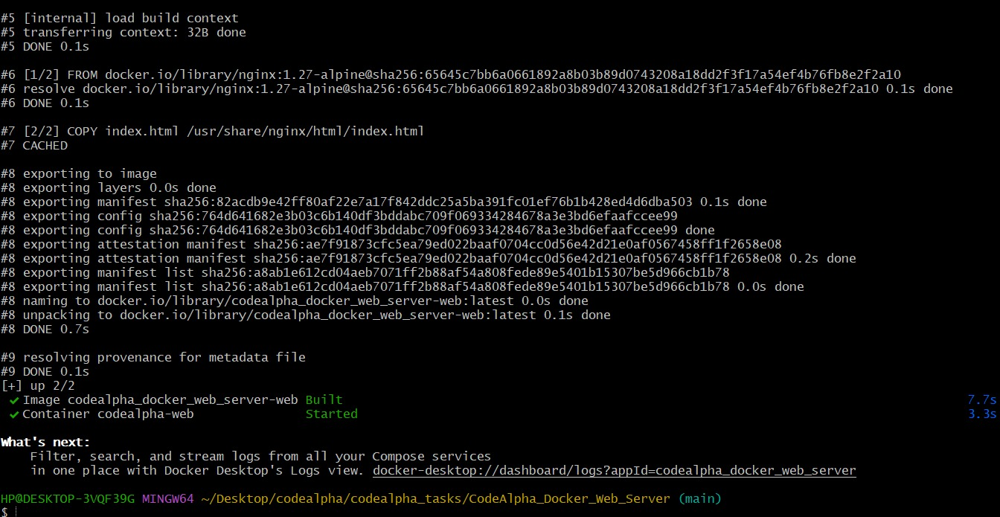
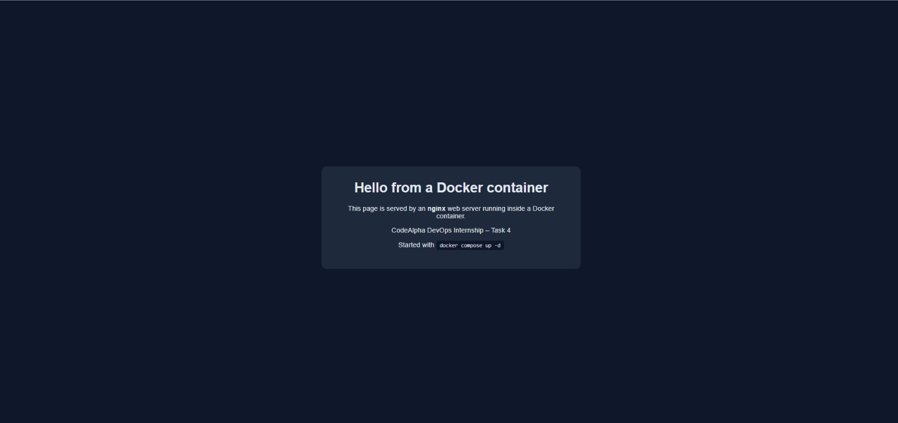
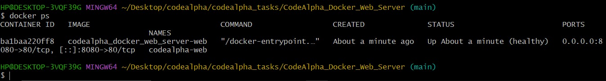
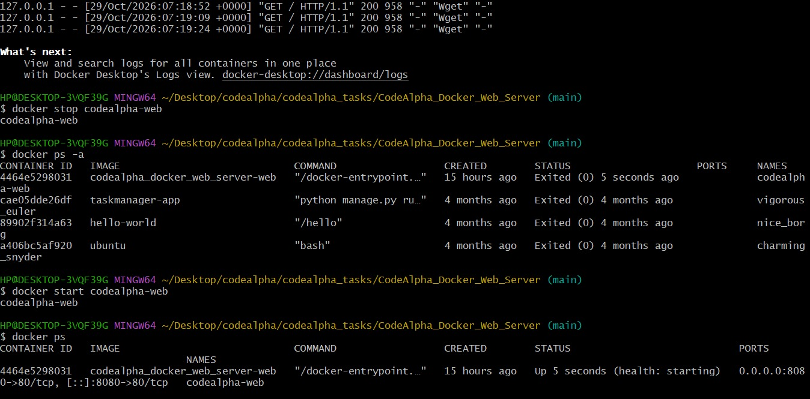
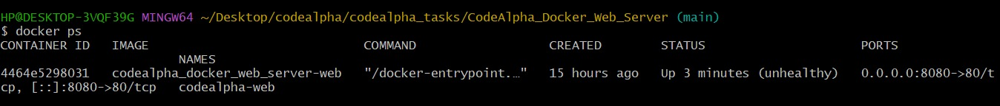
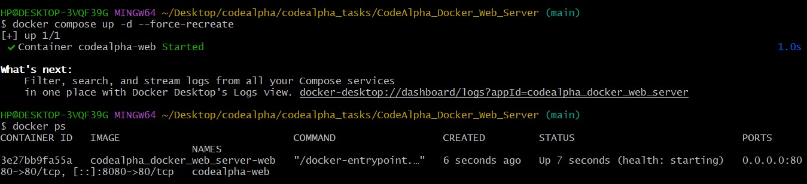

# Task 4: Web Server using Docker

A small static website served by **nginx** inside a Docker container, built with a Dockerfile and run with Docker Compose.

## Files

| File | Purpose |
|------|---------|
| `Dockerfile` | Recipe for the image: nginx base image, copies the web page, declares a health check |
| `index.html` | The web page that nginx serves |
| `docker-compose.yml` | Builds and runs the container with one command and maps port 8080 to the container's port 80 |
| `.dockerignore` | Keeps files that the image does not need out of the build |

## Run it

```bash
cd CodeAlpha_Docker_Web_Server
docker compose up -d --build
```

Open http://localhost:8080 in a browser.

## Container lifecycle commands

```bash
docker build -t codealpha-web .          # build an image from the Dockerfile
docker images                            # list images
docker compose up -d                     # create and start the container in the background
docker ps                                # list running containers (shows the health status)
docker logs codealpha-web                # view the web server logs
docker exec -it codealpha-web sh         # open a shell inside the running container
docker stop codealpha-web                # stop the container
docker start codealpha-web               # start it again
docker restart codealpha-web             # stop and start
docker rm -f codealpha-web               # remove the container
docker compose down                      # stop and remove everything compose created
```

## Monitoring container health

- The `HEALTHCHECK` in the Dockerfile requests the page every 15 seconds. `docker ps` shows `(healthy)` or `(unhealthy)` next to the container.
- `docker inspect --format='{{.State.Health.Status}}' codealpha-web` prints just the health status.
- `docker logs -f codealpha-web` follows the access log live.
- `docker stats codealpha-web` shows live CPU and memory usage.

## Troubleshooting commands

| Problem | What to check |
|---------|---------------|
| Page does not open | `docker ps` (is it running?), then `docker logs codealpha-web` |
| "port is already allocated" | Another program uses port 8080. Change `8080:80` in `docker-compose.yml` to another port |
| Container exits immediately | `docker logs codealpha-web` and `docker inspect codealpha-web` |
| Container shows `unhealthy` | `docker inspect` shows the last health check results |
| Changes to `index.html` do not appear | Rebuild: `docker compose up -d --build` |

## Best practices used

- A pinned, small base image (`nginx:1.27-alpine`) instead of `latest`
- A `HEALTHCHECK` so Docker can tell whether the web server is actually responding
- A `.dockerignore` file to keep the build context small
- `restart: unless-stopped` so the container comes back after a restart
- Infrastructure described as code (Dockerfile and Compose file) so anyone can reproduce it

## Screenshots

Build and start:



Page in the browser:



Container health:



## Container lifecycle test

Logs, stop, status and start of the running container:



## Fault test: health check and troubleshooting

To test monitoring, I deleted `index.html` inside the running container on purpose.

- Result: nginx answered with `403 Forbidden`, the health check failed repeatedly, and `docker ps` showed the container as `unhealthy`.



- Diagnosis: `docker inspect --format='{{json .State.Health}}' codealpha-web` showed the failed health checks with `wget: server returned error: HTTP/1.1 403 Forbidden`, and `docker logs` showed that the directory index of `/usr/share/nginx/html/` was forbidden, meaning the page was missing.
- Fix: `docker compose up -d --force-recreate` created a fresh container from the image, which restored the file. A plain `docker restart` would not help, because changes made inside a container survive a restart.


