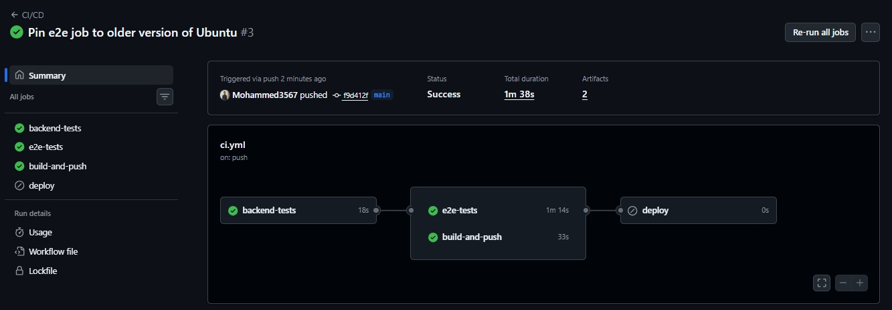
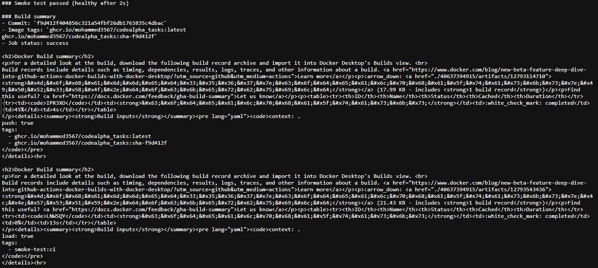
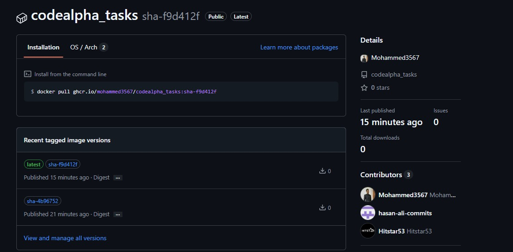

# CodeAlpha Tasks


This repository holds my submissions for the CodeAlpha DevOps internship (1 Oct to 31 Oct 2026).

| Task | Topic | Where |
|------|-------|-------|
| Task 1 | CI/CD pipeline with automated build, registry push and deploy | This repository (root), workflow in `.github/workflows/ci.yml` |
| Task 4 | Web server using Docker | `CodeAlpha_Docker_Web_Server/` |

---

## Task 1: CI/CD Pipeline

### Application used
The pipeline is built around **Yoga-Do (TaskManager)**, a Django REST API with a React frontend. It is an existing college mini project that was built earlier in 2026 by a small team; contributors are listed in the GitHub Contributors view. This repository is a copy of that project with the pipeline changes described below made for Task 1.

### What the pipeline does
Defined in `.github/workflows/ci.yml` and run by GitHub Actions on every push to `main`:

1. **backend-tests**: installs dependencies, runs migrations and runs the Django test suite (`core` app, 13 tests).
2. **e2e-tests**: starts the backend and runs the Playwright browser tests.
3. **build-and-push**: builds the Docker image, starts the container and checks that the API responds (smoke test), then pushes the image to GitHub Container Registry. A run summary is written for each build.
4. **deploy** (optional): pulls the image from the registry and runs it on an AWS EC2 host over SSH. It only runs when the repository variable `ENABLE_DEPLOY` is `true` and the EC2 secrets exist, so it is skipped in this repository.

### How this maps to the Task 1 requirements

| Task 1 requirement | What was used |
|--------------------|---------------|
| CI/CD pipeline with Azure Pipelines | GitHub Actions (same concepts: stages, jobs, triggers, secrets) |
| Azure Container Registry for container storage | GitHub Container Registry (`ghcr.io`) |
| Deploy web app via Azure App Service | Optional SSH deploy to AWS EC2 (not enabled here) |
| Monitor the pipeline for smooth execution | Status badge, per-job results, container smoke test and run summaries |
| Learn key DevOps concepts | Continuous integration, containerisation, registry-based delivery, gated stages |

Azure services were not used in this repository.

### Changes made for Task 1
- Fixed the backend test step. Run from the repository root, Django found no tests, so the pipeline passed without testing anything. It now runs from `backend/` and executes 13 tests.
- Added the container smoke test and the push to GitHub Container Registry.
- Changed the deploy job to pull from the registry, to restart only the application container, and to be optional.
- Pinned the Playwright job to Ubuntu 24.04, because Playwright 1.60 does not support the newer `ubuntu-latest` image.

### Evidence
Pipeline run (all jobs green):



Container smoke test and build summary:



Image in the registry:



Pull the image:

```bash
docker pull ghcr.io/mohammed3567/codealpha_tasks:latest
```

---

## Task 4: Docker Web Server
See [`CodeAlpha_Docker_Web_Server/`](CodeAlpha_Docker_Web_Server/).

---

## About the application (original README)

This repository contains the code and required files for a college project - TaskManager application. The backend is a Django + Django REST Framework API (SQLite for the POC). The frontend is a React + TypeScript SPA that consumes the API.

Quick start (Windows / PowerShell):

```powershell
python -m venv venv
venv\Scripts\Activate.ps1
pip install -r requirements.txt
cd backend
python manage.py migrate
python manage.py createsuperuser
python manage.py runserver
```

API root: `http://127.0.0.1:8000/api/`
